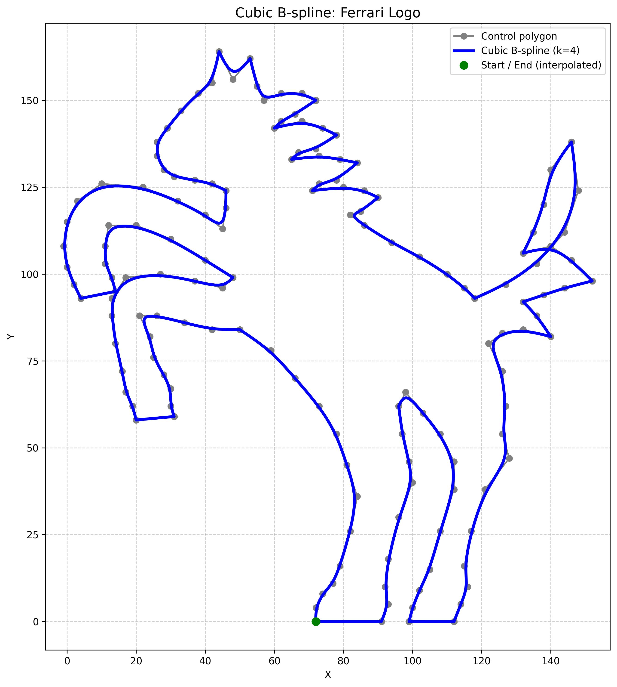

# Cubic B-Spline Outline of the Ferrari Logo

A closed outline of the Ferrari prancing horse (facing left), drawn with a **cubic B-spline (order k = 4)** whose control points were designed by hand. The B-spline evaluator is written from scratch in NumPy using the Cox–de Boor recursion, so no spline library is used.

<p align="center">
  
</p>

## Features

- Cox–de Boor basis function and B-spline curve evaluation in plain Python/NumPy
- Open-uniform knot vector generated automatically
- Sharp corners (hooves, ear tips, mane tufts, tail tips) made by repeating a control point three times
- 206 control points describing one closed outline
- A `RUN_SHARP_DEMO` flag that shows the alternative sharp-corner method: a custom knot vector with an interior knot repeated k − 1 = 3 times
- Plot of the control polygon, the curve and the start/end point, saved as `b_spline_curve.jpg`
- Printout of the control points and knot vector, ready to copy into a report

## Contents

| File | Description |
|------|-------------|
| `ferrari_logo.ipynb` | Jupyter notebook with the B-spline code, the horse control points and the plot |
| `b_spline_curve.jpg` | Output image saved by the notebook |

## Getting started

### Requirements

- Python 3.9 or newer
- `numpy`
- `matplotlib`
- Jupyter (to open the notebook)

```bash
pip install numpy matplotlib jupyter
```

### Run it

```bash
git clone https://github.com/YOUR-USERNAME/YOUR-REPOSITORY.git
cd BSpline-ferrari-logo
jupyter notebook ferrari_logo.ipynb
```

Run the first cell. It draws the horse, saves `b_spline_curve.jpg` in the working directory, and prints the control points and the knot vector.

To see the sharp-corner demo (an L-shaped curve with a repeated interior knot), set `RUN_SHARP_DEMO = True` near the top of the student-input section and run the cell again.

## How it works

A B-spline curve of order *k* with control points *P₀ … Pₙ₋₁* is

```
C(t) = Σ Pᵢ · Nᵢ,ₖ(t)
```

where the basis functions come from the Cox–de Boor recursion:

```
Nᵢ,₁(t) = 1 if tᵢ ≤ t < tᵢ₊₁, else 0
Nᵢ,ₖ(t) = (t − tᵢ)/(tᵢ₊ₖ₋₁ − tᵢ) · Nᵢ,ₖ₋₁(t) + (tᵢ₊ₖ − t)/(tᵢ₊ₖ − tᵢ₊₁) · Nᵢ₊₁,ₖ₋₁(t)
```

The code in the notebook:

- `basis_function(i, k, t, knots)` evaluates one basis function.
- `generate_open_uniform_knots(n_ctrl, k)` builds a knot vector of length *n + k*, with the first and last *k* knots repeated so the curve starts and ends at the first and last control points.
- `b_spline_curve(control_points, k, num_samples, knots)` samples the curve at evenly spaced parameter values and returns the points and the knot vector.

### Why the corners are sharp

A cubic B-spline normally rounds off every bend. For a uniform cubic B-spline the curve value at a knot is `(Pⱼ₋₁ + 4Pⱼ + Pⱼ₊₁) / 6`. If the same point is entered three times in a row, the curve passes exactly through it with zero tangent, which produces a sharp geometric corner. The horse uses this for hoof edges, ear tips, mane tufts, the elbow, the crotch and the tail tips.

### Numbers for the final horse

| Item | Value |
|------|-------|
| Order | k = 4 (cubic) |
| Control points | 206 (including repeats for sharp corners) |
| Knot vector | open-uniform, length 210 |
| Start / end point | (72, 0), the toe of the forward hind hoof |
| Continuity | C² everywhere along the curve; corners come from repeated control points |

## Editing the shape

Control points are in the `control_points` list in the `else:` branch of the notebook. They are listed clockwise around the outline, starting and ending at the same point so the loop closes. To change the horse:

1. Move a point and re-run the cell. Because of local support, a point only affects four knot spans.
2. Repeat a point three times to make it a sharp corner, or enter it once to keep it rounded.
3. Use the grey control polygon in the plot to see which point is pulling the curve where.

## AI assistance

This project was developed with help from Claude (Anthropic) for the horse design and for drafting the report. The prompts used are listed in the report.

## Author

Chris Varghese Mathew, Roll No. B240029ME, ME-02

## License

Add a license of your choice here (for example, MIT) before publishing.
